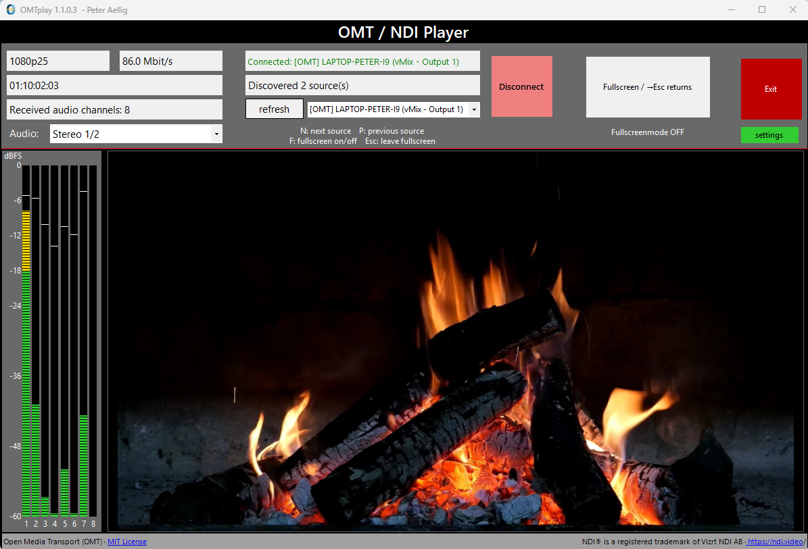

# OMT / NDI Player

A Windows desktop player for **Open Media Transport (OMT)** and **NDI** sources, built with C# and Windows Forms. The executable is named **OMTplay**.



## Download

Download the Windows x64 installer from [Releases](https://github.com/peteraellig/OMT-NDI-Player/releases/latest).

Version **1.1.0.3** supports Windows 10 (1809 or later) and Windows 11, x64. The installer includes the .NET runtime and required playback libraries. Installation requests administrator privileges.

## Features

- Discover OMT and NDI sources in one list and play video with audio.
- Switch sources with **N** (next) and **P** (previous), including in fullscreen.
- **F** toggles fullscreen; **Esc** returns to the window.
- Listen to stereo pairs **1/2, 3/4, 5/6, 7/8**, or duplicate any single input channel **1–8** to both speakers.
- Vertical input audio meters show the received channel count, up to eight channels, independently of the listening selection.
- Meter colors, thresholds, spacing, peak hold and scale visibility are editable in the Visual Studio designer.
- OMT video + audio receive rate in Mbit/s; NDI bandwidth displays **n/a** because the standard receive API does not expose network byte counters.
- Optional automatic connection and fullscreen at startup.
- Optional HTTP API with a configurable port and password.

## Getting started

1. Start an OMT or NDI output on your sender, for example vMix.
2. Open OMTplay, select a discovered source and click **Connect**.
3. Choose the audio pair or mono channel to monitor.
4. Open **Settings** to configure startup, receive quality and the API.

Discovery and reception require network access between the sender and this PC. Allow the application through Windows Firewall on the network you use for your sources if necessary.

### Receive quality

Settings take effect on the **next connection**: save, disconnect and reconnect.

| Setting | Choices | Behavior |
| --- | --- | --- |
| OMT quality preference | Default, Low, Medium, High | A request to the sender. A fixed sender quality takes precedence. With an automatic sender, the highest receiver preference wins. |
| NDI receive bandwidth | Highest, Lowest | Highest requests full resolution; Lowest requests reduced bandwidth and resolution. |

Defaults retain normal playback: OMT Default and NDI Highest. These settings do not select the sender's codec or turn an NDI High Bandwidth source into NDI HX.

## HTTP API

Enable **API enabled (network)** in Settings and click **SAVE**. The default port is **25901**. The API listens on all network interfaces while enabled. Settings changes apply immediately.

```text
http://127.0.0.1:25901/api/?Function=next
http://<player-pc-ip>:25901/api/?Function=next&Password=MyPassword
```

Use HTTP GET. Replace the IP address when calling from another device.

| Function | Action |
| --- | --- |
| `prev` | Select and connect the previous source; wrap around the list. |
| `next` | Select and connect the next source; wrap around the list. |
| `fullOn` | Enter fullscreen; requires a connected source. |
| `fullOFF` | Leave fullscreen. |
| `connect` | Connect the selected source; an already connected selection stays connected. |

Function names are case-insensitive. Repeating `fullOn` or `fullOFF` does not toggle the state. Source changes preserve fullscreen.

The optional password is case-sensitive. Use **Show** to reveal or edit it in Settings. An empty password disables password checking. Add it with **`&Password=`**, not a second `?`. URL-encode special characters in the password, for example `&` as `%26` and `+` as `%2B`. HTTP is unencrypted and query passwords can appear in browser history or request logs.

Responses: **200** OK, **400** unknown function, **401** incorrect/missing password, **409** no suitable source/connection, **500** execution error, **503** stopping/unavailable. An API Help window is also available in Settings.

## Build from source

Requirements: Windows x64, .NET 8 SDK (or a compatible newer SDK). Visual Studio with .NET desktop development can open `OMTplay.sln`. Controls and layout are editable in the WinForms designer.

```powershell
dotnet build OMTplay/OMTplay.csproj -c Release -p:Platform=x64
```

The project uses NAudio 2.2.1 and the ASP.NET Core shared framework for its HTTP listener. Required OMT and NDI playback binaries are in `OMTplay/third_party`, together with their license notices.

### Tests

```powershell
dotnet build OMTplay.SmokeTests/OMTplay.SmokeTests.csproj -c Release -p:Platform=x64 -o artifacts/tests
./artifacts/tests/OMTplay.SmokeTests.exe --offline
```

The offline suite exercises audio routing, metering, video conversion, source navigation, fullscreen and HTTP commands/passwords. It creates temporary local OMT sources and requires a working Windows audio output. Omit `--offline` for additional live-source tests; these require available vMix OMT and NDI signals.

### Installer

Install **Inno Setup 7**, then run:

```powershell
./Build-Installer.ps1
```

The script publishes a self-contained x64 application and builds `artifacts/installer/OMTplay-1.1.0.3-Setup-x64.exe`. It prints the SHA-256 checksum. An alternative compiler path can be supplied through `-InnoCompiler`.

## Credits and third-party notices

Application credits: **Peter Aellig / Nicos Manadis**. Existing application copyright metadata is retained.

- [Open Media Transport](https://www.openmediatransport.org/): [MIT license](OMTplay/third_party/omt/LICENSE.txt).
- [NDI](https://ndi.video/): NDI is a registered trademark of Vizrt NDI AB. NDI components are distributed under their own [SDK license agreement](OMTplay/third_party/ndi/NDI%20SDK%20License%20Agreement.pdf) and [third-party notices](OMTplay/third_party/ndi/Processing.NDI.Lib.Licenses.txt).
- [NAudio](https://github.com/naudio/NAudio): [MIT license](installer/licenses/NAudio-LICENSE.txt).
- .NET: [license](installer/licenses/DotNet-LICENSE.txt) and [third-party notices](installer/licenses/DotNet-THIRD-PARTY-NOTICES.txt).

Third-party licenses apply to their respective components; they do not relicense the application source. Installed copies include a `licenses` directory.
